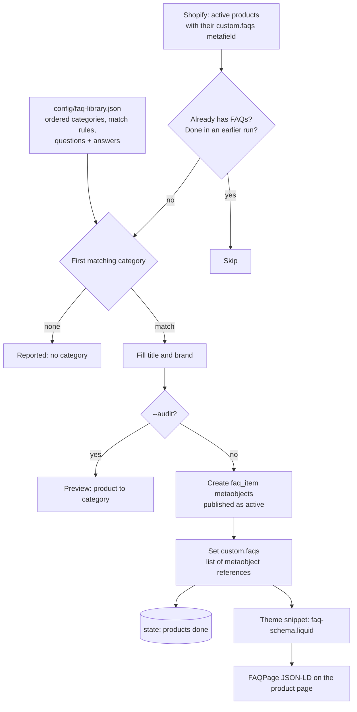

# Shopify FAQ Schema: questions and answers on every product page, as structured data search engines can read

Two scripts. The first gives every product that has no FAQs a set of questions and answers, chosen by product category and stored as Shopify metaobjects. The second adds a snippet to the theme that renders those FAQs as FAQPage structured data on each product page.

## The problem

Search results for product keywords are full of question boxes: what is it, how is it made, how do you store it. A product page that answers those questions in a form search engines can parse is eligible for richer results and gets quoted more often. Most product pages carry no FAQ content at all.

Adding FAQs by hand works for ten products and not for a catalog. Writing them in the description mixes content with markup and cannot be reused. And doing it once is not enough: new products keep arriving without any.

## What it does

| Script | What happens |
|---|---|
| `src/generate-faqs.js` | Fetches all active products. Skips any that already have FAQs. Assigns each remaining product to a category from the FAQ library, creates that category's questions and answers as `faq_item` metaobjects, and links them to the product through the `custom.faqs` metafield |
| `src/inject-faq-schema.js` | Finds the published theme, uploads a snippet that renders FAQPage JSON-LD from the metafield, and adds the render tag to the product template or section if it is not already there |

The FAQ library lives in `config/faq-library.json`: an ordered list of categories, each with matching rules and its questions and answers. `{title}` and `{brand}` are filled in per product.

## Architecture



## Key design decisions

**FAQs are data, not page copy.** Each question and answer is a metaobject, and the product holds a list of references. The same content can be rendered as structured data, shown in an accordion by the theme, or edited in the admin, without touching the product description.

**Category first, then content.** A product is matched to a category by fragments of its handle, type and title, with exclusions and a wholesale switch. Categories are checked in order and the first match wins, so a specific category placed above a general one takes precedence.

**Existing FAQs are never replaced.** A product whose metafield already has a value is skipped. The tool fills gaps; it does not overwrite what someone wrote.

**Products with no category are listed, not guessed at.** Anything that matches nothing is reported by title and handle. That list is the prompt to add a category to the library.

**Metaobjects are created as active.** A metaobject created without a publish status starts as a draft and does not render on the storefront. The first production batch was created that way and had to be published afterward, so the create call now sets the status explicitly.

**Audit before writing.** `--audit` shows which product gets which category and writes nothing. `--category` and `--limit` allow a small first run.

**Resumable.** Each finished product is recorded. A rerun after an error or rate limit continues with the products that are left.

**The theme change is small and idempotent.** The snippet is uploaded as its own file. The render tag is added only where it is missing, before the section schema or at the end of the template, and the original file is backed up before the first change. JSON templates are left alone.

**Output is escaped by Liquid.** Questions and answers pass through Liquid's `json` filter, so quotes and special characters in the content cannot break the structured data.

## Repository layout

```
src/generate-faqs.js              category matching, metaobject creation, metafield assignment
src/inject-faq-schema.js          theme snippet upload and render tag injection
config/faq-library.example.json   example categories with questions and answers
scripts/test-faqs.js              offline tests for matching, filling and the snippet
```

## Setup

Requires Node 20+ and a Shopify Admin API token with read and write access to products, metaobjects, metafields and themes. The store needs a `faq_item` metaobject definition with `question` and `answer` fields, and a product metafield definition `custom.faqs` of type list of metaobject references.

```bash
npm install
npm test                                                     # offline, no store needed
cp .env.example .env                                         # store and token
cp config/faq-library.example.json config/faq-library.json   # your categories and FAQs
npm run audit                                                # which product gets which category
node src/generate-faqs.js --limit 5                          # small first run
npm run generate
npm run schema:preview                                       # theme change, dry run
npm run schema
```

| Variable | Purpose |
|---|---|
| `SHOPIFY_STORE`, `SHOPIFY_ADMIN_TOKEN` | Products, metaobjects, metafields and theme assets |
| `COMPANY_NAME` | Optional override of `brand` in the library |
| `CONFIG_DIR`, `STATE_DIR`, `BACKUP_DIR` | Optional location overrides |

Answers should be accurate and visible on the page they describe. Structured data that does not match page content can be ignored or penalized by search engines.

---

Extracted from a production automation suite I built and ran for a live e-commerce and B2B wholesale business, 2026.

© Michael Wootan. Source shared for portfolio review; all rights reserved.
